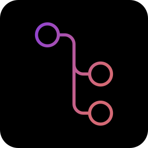
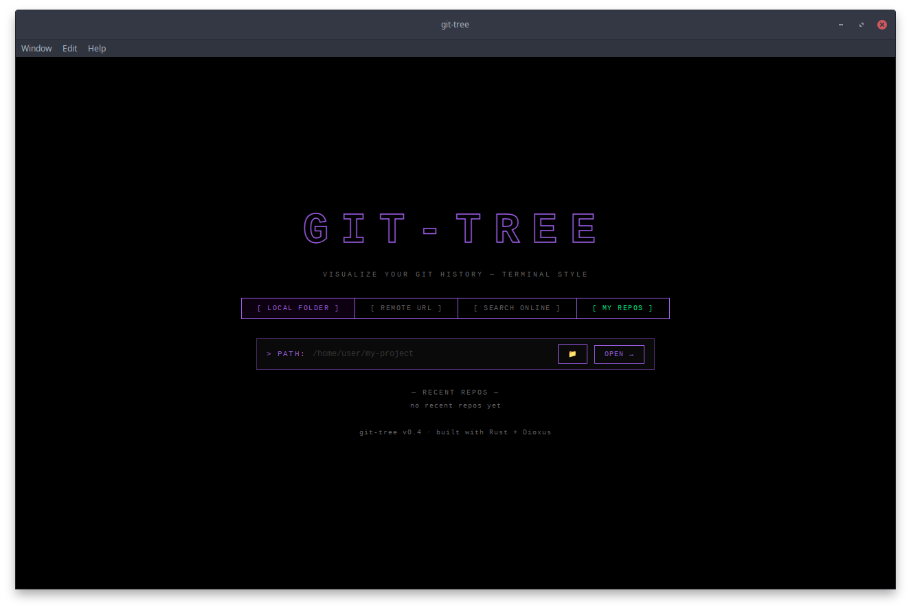
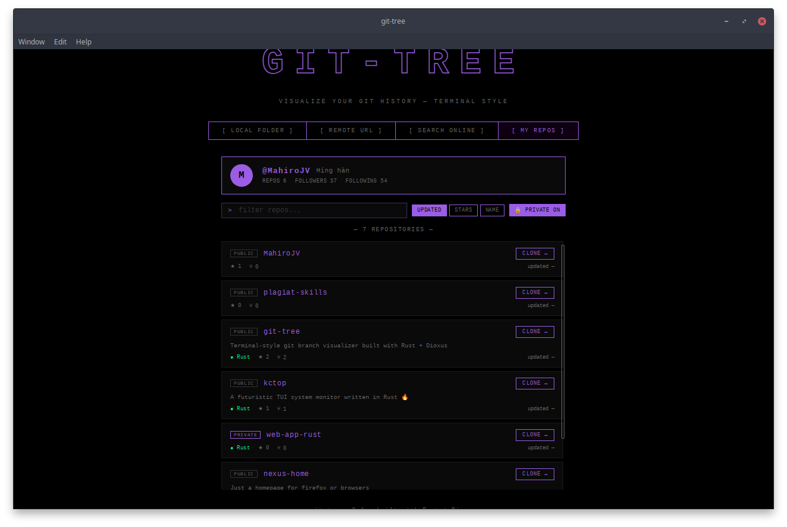
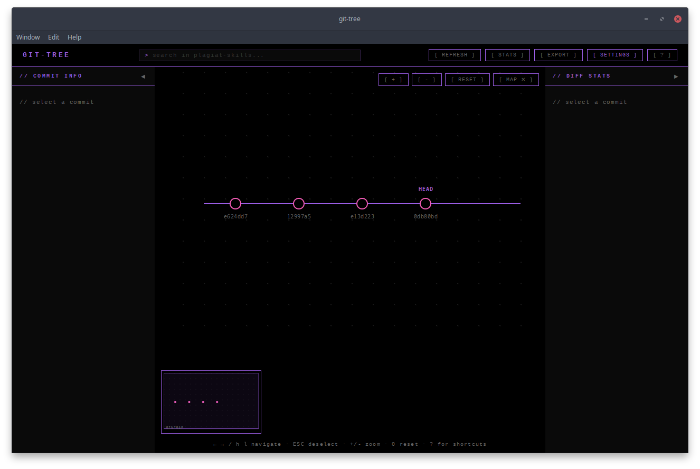
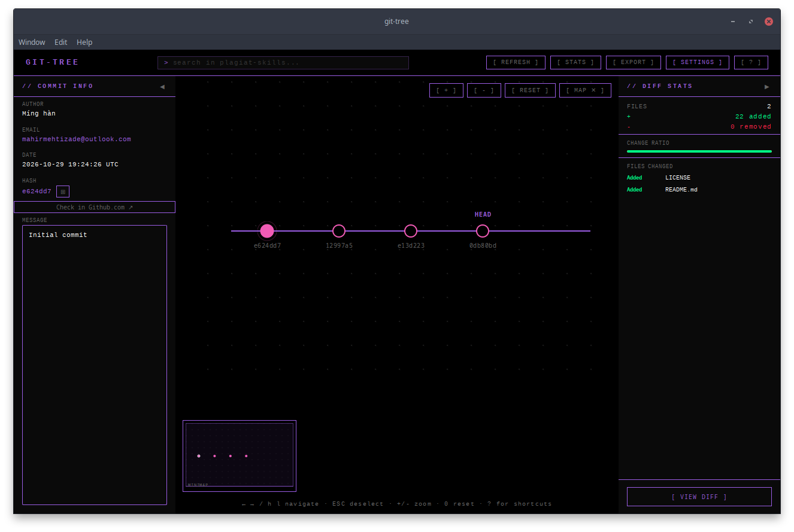
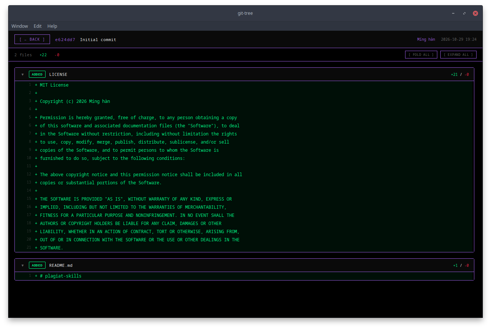
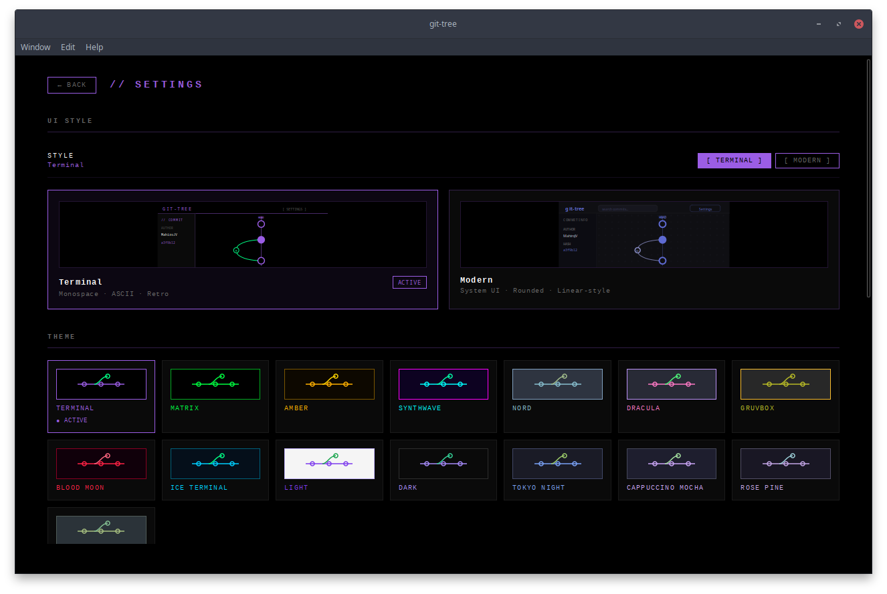
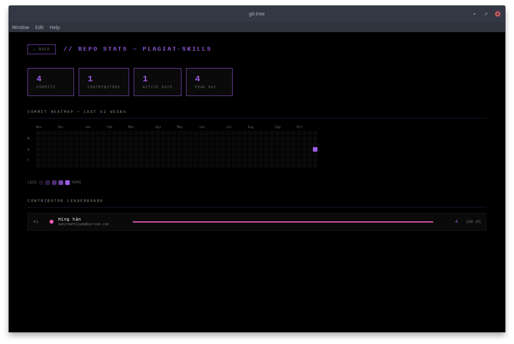
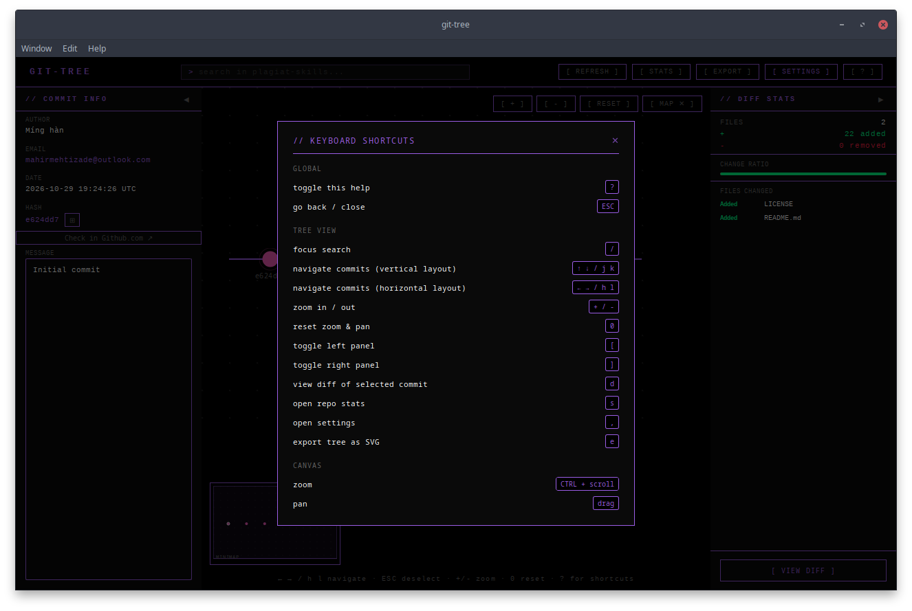

<div align="center">
  
  <h1>git-tree</h1>

  <p><i>Terminal-style git branch visualizer — built with Rust + Dioxus</i></p>

  <p>
   
   
   
   
   <br> 
   
   
      
   
   <br>
    
   
   
  </p>
</div>

---

## ✨ Overview

**git-tree** is a desktop Git visualizer that turns commit history into an interactive tree.

Explore branches, inspect commits, view diffs, and analyze repository activity in a clean terminal-style UI.

---

## Screenshots

<summary>Screenshot Gallery</summary>

<p align="center">
    
    
    
    
    
    
    
    
</p>


---
## ⚡ Features

- 🌳 Interactive commit tree (horizontal & vertical)
- 🔍 Commit search (author, message, hash)
- 📄 Full diff viewer with collapsible files
- 🧭 Minimap navigation
- 📊 Repository statistics (contributors + heatmap)
- 🎨 15 built-in themes
- 🖱️ Mouse + keyboard navigation
- 🔗 Open commits in GitHub/GitLab
- 📁 Clone or open local repositories
- ⚡ Fast native Rust performance

---

# Installation

### Linux (recommended)

**1. Install system dependencies**

## 
```bash
sudo apt update
sudo apt install -y \
  libgit2-dev \
  libwebkit2gtk-4.1-dev \
  libgtk-3-dev \
  libglib2.0-dev \
  libcairo2-dev \
  libpango1.0-dev \
  libxdo-dev \
  pkg-config
```

## 
```bash
sudo pacman -S libgit2 webkit2gtk-4.1 gtk3 base-devel
```
### 🚀 Recommended Installation for Arch 

For the best experience, use the official installer:

```bash id="lnx03"
curl -fsSL https://raw.githubusercontent.com/MahiroJV/git-tree/master/scripts/install.sh | bash
```

## 
```bash
sudo dnf install libgit2-devel webkit2gtk4.1-devel gtk3-devel
```

## 

The prebuilt binary links against Ubuntu's `libxdo.so.3` and won't run on NixOS
(nixpkgs ships `libxdo.so.4`). Build from source instead — no extra setup needed:

```bash
# Flakes: run without installing
nix run github:MahiroJV/git-tree

# Flakes: install to your profile
nix profile install github:MahiroJV/git-tree
```

```bash
# Classic Nix (from a clone of this repo)
nix-shell
cargo run --release
```

Or add it to a flake-based NixOS / home-manager configuration:

```nix
inputs.git-tree.url = "github:MahiroJV/git-tree";

# then in configuration.nix / home.nix:
environment.systemPackages = [ inputs.git-tree.packages.${pkgs.system}.default ];
```

> Don't symlink `libxdo.so.4` → `libxdo.so.3`; it only works by luck.
> If the window is black, try `WEBKIT_DISABLE_COMPOSITING_MODE=1 git-tree`
> (`WEBKIT_DISABLE_DMABUF_RENDERER=1` is already set by the app).
---

**2. Download the binary**

Grab the latest release from the [Releases page](https://github.com/MahiroJV/git-tree/releases/latest):

```bash
wget https://github.com/MahiroJV/git-tree/releases/latest/download/git-tree-linux-x86_64
chmod +x git-tree-linux-x86_64
./git-tree-linux-x86_64
```

Or move it to your PATH for system-wide access:
```bash
sudo mv git-tree-linux-x86_64 /usr/local/bin/git-tree
git-tree
```

**AppImage (no dependencies needed):**
```bash
chmod +x git-tree-*-x86_64.AppImage
./git-tree-*-x86_64.AppImage
```
---

### ↩️ Restore the original state (uninstall / undo)

If nothing above worked, or you just want to remove git-tree, this undoes every change the install steps made.

#### 🗑️ Uninstall script (recommended)

The script finds how git-tree was installed and removes it, asking before anything that needs `sudo`:

```bash
curl -fsSL https://raw.githubusercontent.com/MahiroJV/git-tree/master/scripts/uninstall.sh -o uninstall.sh
chmod +x uninstall.sh
./uninstall.sh
```

| Option | What it does |
|---|---|
| *(none)* | Remove the app, keep your settings |
| `--purge` | Also delete settings, recent repos and GitHub login |
| `--yes` | Don't ask for confirmation |

From a clone of this repo, just run `./scripts/uninstall.sh`.

> System packages (webkit2gtk, gtk3, xdotool, …) are never removed, because other apps often need them.

#### Manual uninstall

Prefer to do it by hand? Run only the parts that match how you installed it.

**Installed with `install.sh`:**
```bash
rm -f ~/.local/bin/git-tree
rm -f ~/.local/share/applications/git-tree.desktop
rm -f ~/.local/share/icons/hicolor/256x256/apps/git-tree.png
update-desktop-database ~/.local/share/applications 2>/dev/null || true
```

**Arch: remove the `libxdo.so.3` symlink** (created by `install.sh` or by hand).
Only delete it if no package owns it:
```bash
pacman -Qo /usr/lib/libxdo.so.3 || sudo rm /usr/lib/libxdo.so.3
```

**Installed the binary manually:**
```bash
sudo rm -f /usr/local/bin/git-tree
```

**Installed from the AUR:**
```bash
sudo pacman -Rns git-tree-bin
```

**NixOS:**
```bash
nix profile remove git-tree      # if you used `nix profile install`
nix-collect-garbage              # free the space in /nix/store
```
If you added it to `configuration.nix` / `home.nix`, remove that line and rebuild (`sudo nixos-rebuild switch` or `home-manager switch`).
If you used the `libxdo` symlink workaround, remove it and open a new terminal so `LD_LIBRARY_PATH` is reset:
```bash
rm -rf /tmp/libxdo
```

**Reset settings, recent repos and GitHub login** (optional, for all install methods):
```bash
rm -rf ~/.config/git-tree ~/.local/share/git-tree
```

> System packages installed in step 1 (webkit2gtk, gtk3, xdotool, …) are left alone on purpose, because other apps often need them. Remove them with your package manager only if you're sure nothing else uses them.

---
# Documentation
**If you have any problems with installation, please check the [Wiki](https://github.com/MahiroJV/git-tree/wiki).**

---

## Build from source

**Requirements:**
- Rust 1.75+
- Dioxus CLI
- System dependencies (see above)

```bash
# Clone the repo
git clone https://github.com/MahiroJV/git-tree
cd git-tree

# Install Dioxus CLI
cargo install dioxus-cli

# Run in dev mode
dx serve --platform desktop

# Build release binary
dx build --platform desktop --release
# Binary will be at: dist/git-tree
```

---

## Usage

**Open a local repo:**
1. Launch git-tree
2. Make sure `[ LOCAL FOLDER ]` tab is selected
3. Type the full path to your repo or use the 📁 picker
4. Click `OPEN →`

**Clone a remote repo:**
1. Click `[ REMOTE URL ]` tab
2. Paste a GitHub/GitLab URL (e.g. `https://github.com/user/repo`)
3. Click `CLONE →`
4. git-tree clones it to a temp folder and opens it

**Search GitHub:**
1. Click `[ SEARCH ONLINE ]` tab
2. Type any query (e.g. `rust async runtime`)
3. Hit Enter or click `SEARCH →`
4. Click `CLONE →` on any result to open it instantly

**Navigating the tree:**
- Click any commit node → left panel shows commit info, right panel shows diff stats
- `← →` (horizontal) or `↑ ↓` (vertical) to move between commits
- `ESC` to deselect
- `CTRL+scroll` to zoom, drag to pan
- Click anywhere on the **minimap** to jump to that region
- Toolbar → `[ VIEW DIFF ]` to open the full diff viewer
- Toolbar → `[ STATS ]` to open the repo stats screen

**Keyboard shortcuts:** (press `?` any time to see this list in-app)
- `← → / ↑ ↓` or `h l / j k` — navigate commits
- `+ / -` zoom, `0` reset zoom & pan
- `[` / `]` — toggle left / right panel
- `/` — focus search · `d` — view diff · `s` — stats · `,` — settings · `e` — export SVG
- `ESC` — back / deselect · `?` — toggle shortcuts help

**Settings:**
- 15 themes with live preview
- Font size, node spacing, merge commit visibility
- Tree direction (Horizontal / Vertical)
- Branch style (Curved / Geometric)
- CRT scanline overlay

---

## Themes

| Name | Description |
|---|---|
| **Terminal** | Black + purple — default |
| **Matrix** | Hacker green |
| **Amber** | Old phosphor monitor |
| **Synthwave** | 80s retrowave |
| **Nord** | Cold Nordic blues |
| **Dracula** | Popular dark dev theme |
| **Gruvbox** | Warm retro |
| **Blood Moon** | Dark dramatic red |
| **Ice Terminal** | Cold blue cyberpunk |
| **Light** | Paper white, clean |
| **Dark** | Deeper black than Terminal |
| **Tokyo Night** | Deep blue city lights |
| **Cappuccino Mocha** | Catppuccin-inspired warm dark |
| **Rose Pine** | Muted dawn purple |
| **Everforest** | Muted forest green |

---

## 🚀 Roadmap

---

### 🧱 v0.1 — Foundation ✅
- [x] Tree visualization
- [x] Click panels (commit info + diff stats)
- [x] 9 themes
- [x] Contributor colors
- [x] Local + remote clone
- [x] Zoom + pan
- [x] App icon

---

### 🧪 v0.2 — Usability ✅
- [x] Search by author / message / hash
- [x] Diff viewer (actual +/- code lines with collapse)
- [x] Keyboard navigation (arrow keys between commits)
- [x] Fix font loading (Space Mono offline)
- [x] Recent repositories list with filter
- [x] Copy hash button
- [x] Vertical tree layout
- [x] Settings panel (font size, node spacing, merge visibility)
- [x] CRT scanline overlay
- [x] 2 extra themes (Light, Dark)

---

### 🎨 v0.3 — Polish ✅
- [x] Minimap (corner overview of the full tree, click-to-navigate)
- [x] Repo stats (contributor leaderboard + commit heatmap)
- [x] Open commit in browser (GitHub / GitLab)
- [x] Node pulse animation on click
- [x] GitHub repository search + one-click clone
- [x] Curved and geometric branch connector styles
- [x] 4 extra themes (Tokyo Night, Cappuccino Mocha, Rose Pine, Everforest)
- [x] Export tree as SVG or PNG

---

### 🖥️ v0.4 — Platform
- [x] GitHub OAuth login (private repo access)
- [x] Windows installer (MSI via cargo-wix)
- [x] macOS build

---

### 🏁 v1.0 — Release
- [x] Full keyboard shortcut system
- [ ] Performance improvements for very large repos
- [ ] Community themes

---

## Project Structure

```
src/
├── main.rs                 # Entry point, window config
├── app.rs                  # Root component + global state
├── theme.rs                # 15 themes + contributor color engine
├── recent.rs               # Recent repos persistence (~/.config/git-tree/)
├── components/
│   ├── home_screen.rs      # Repo open/clone/search screen + recent list
│   ├── user_repos.rs       # user private/public profile repos
│   ├── toolbar.rs          # Top navigation + search bar
│   ├── tree_canvas.rs      # SVG tree (horizontal + vertical + minimap)
│   ├── left_panel.rs       # Commit details + copy hash
│   ├── right_panel.rs      # Diff stats + file list
│   ├── diff_viewer.rs      # Full diff viewer with per-file collapse
│   ├── stats.rs            # Repo stats (heatmap + contributor leaderboard)
│   └── settings.rs         # Theme selector + display options
└── git/
    ├── loader.rs           # Open local / clone remote
    ├── parser.rs           # Git history → tree data structures
    ├── search.rs           # GitHub API search
    ├── auth.rs             # Github OAuth login
    ├── export.rs           # img/svg export
    └── url.rs              # Remote URL → browser URL conversion

assets/
├── css/
│   ├── style.css           # Core terminal theme + layout
│   ├── diff_viewer.css     # Diff viewer styles
│   ├── left_panel.css      # Left panel styles
│   ├── right_panel.css     # Right panel styles
│   ├── panel_shared.css    # Shared collapse/expand styles
│   └── stats.css           # Stats screen styles
└── fonts/
    ├── Oxanium.ttf
    └── SpaceMono-Regular.woff2
```

---

## Requirements

| Dependency | Version |
|---|---|
| Rust | 1.75+ |
| Dioxus | 0.6 |
| git2 | 0.19 |
| libgit2 | system |
| webkit2gtk | 4.1 (Linux) |

---

## Author

**MahiroJV** — [github.com/MahiroJV](https://github.com/MahiroJV)

Built with Rust + Dioxus 🦀

---

## License

MIT
